

<h1 align="center">Ember for Thunderbird</h1>

A calmer, faster way through your email, inside Thunderbird on your Mac.

Ember replaces Thunderbird's everyday window with a clean mail app: a Smart Inbox across all your accounts, conversations, quick actions, an in-app composer, and a calendar. Thunderbird keeps doing what it's good at in the background: your accounts, syncing, storage and sending.

**[Download the latest version](https://github.com/MerrittFranzmann/ember-for-thunderbird/releases/latest)**

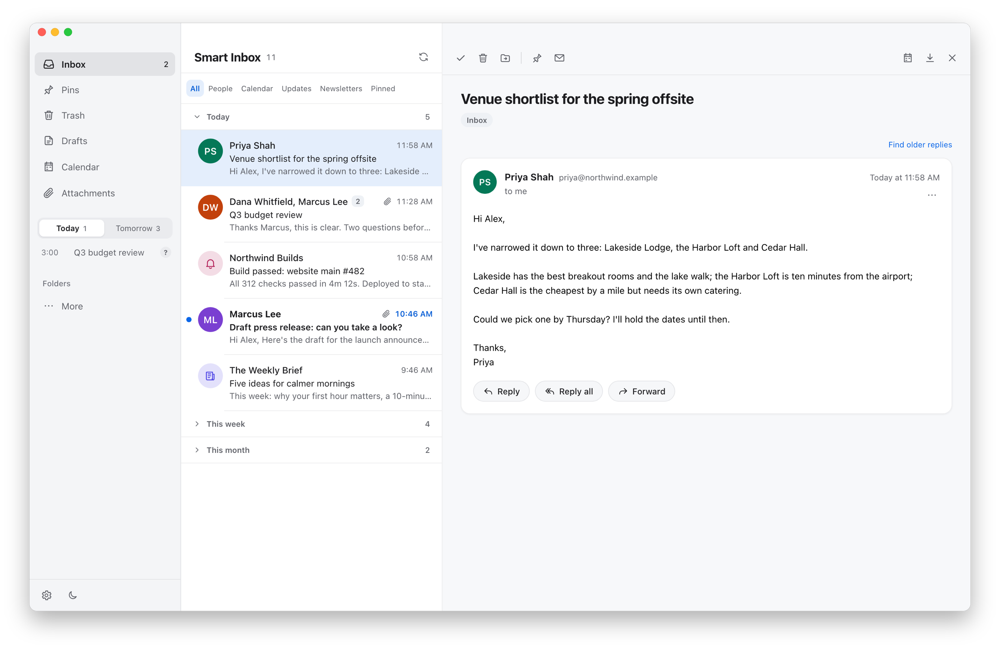

## What you need

- A Mac.
- **Thunderbird 158 or newer** ([download Thunderbird](https://www.thunderbird.net)). To check yours: Thunderbird → About Thunderbird.

## Install

1. Download `ember-<version>.xpi` from the [latest release](https://github.com/MerrittFranzmann/ember-for-thunderbird/releases/latest). If your browser asks, keep the file.
2. In Thunderbird, open **Tools → Add-ons and Themes** (or the ☰ menu → Add-ons and Themes).
3. Click the **gear** button, choose **Install Add-on From File…**, and pick the file you downloaded.
4. Thunderbird says Ember can access everything in Thunderbird and on your computer. Ember needs that to show your calendar, run its own window and keep itself up to date. Click **Add**.

Ember opens in its own window. If Thunderbird has no email account yet, click **Add an email account**: Gmail, Outlook and Microsoft 365, iCloud, Exchange and most other providers set themselves up from your address.

## Updates

Ember updates itself. New versions come from this page's releases, and Ember installs only versions signed by its publisher. They install while you're not using Ember, never while you're writing an email, and Ember reopens where you were. To check now: **Settings → Updates**.

## A look around

### Email that's easy to read

Emails arrive in every font, size and shade of grey their senders pasted together. Ember shows ordinary text in one clear font, size and colour, and keeps what matters: bold, links, lists, deliberate colours, and the design of newsletters. (Settings → Reading → Standardise email text.)

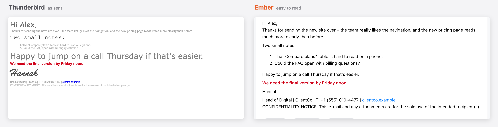

### Conversations

Replies are grouped into one conversation, oldest to newest, with earlier messages folded away.

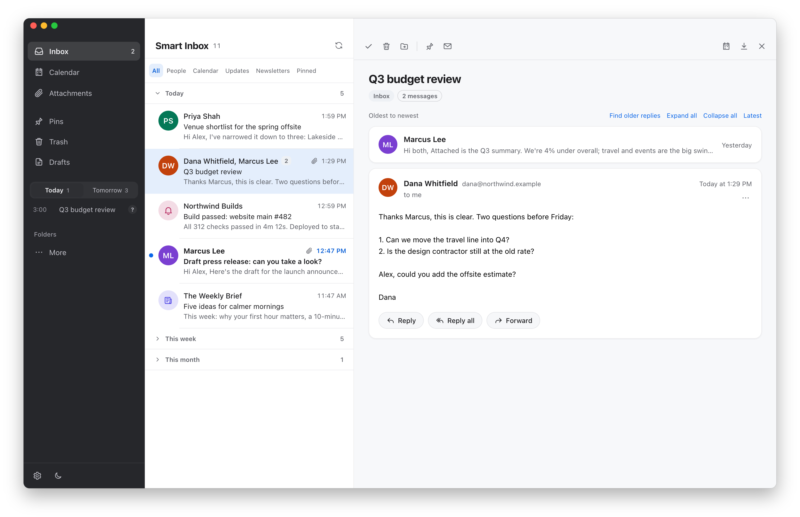

### Top of inbox

What needs you can sit above everything else, with a note saying why, put there by you or by an AI agent you've allowed.

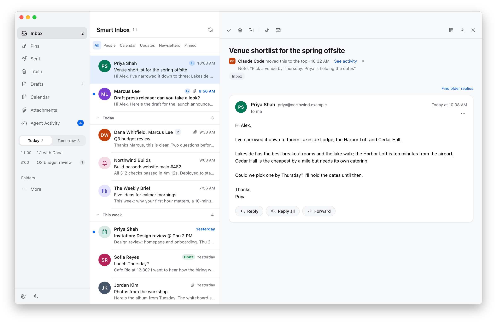

### Calendar

For Exchange and Microsoft 365 accounts: day, week, month and year; create and change events; answer invitations; and see which emails are about a meeting.

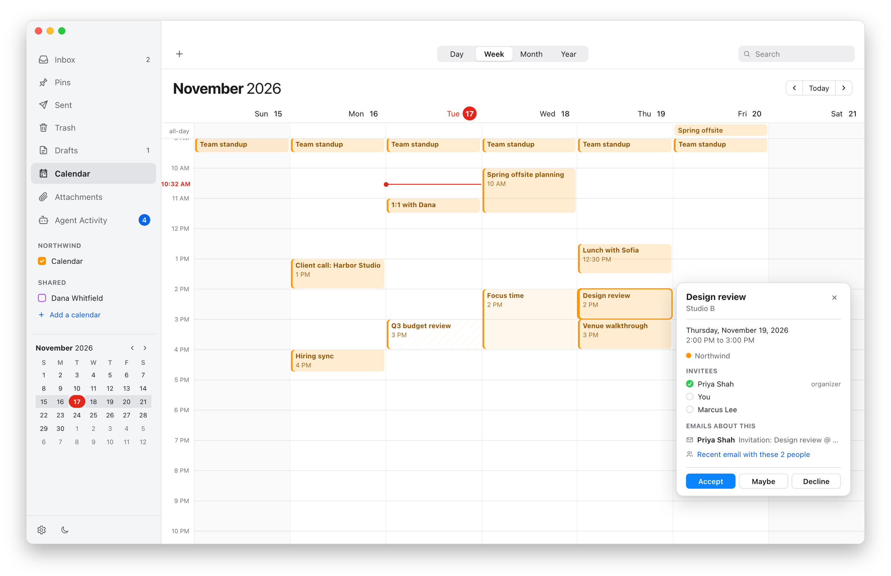

**Find a time.** Add people to an event and Ember shows when everyone is busy, and suggests times when you're all free.

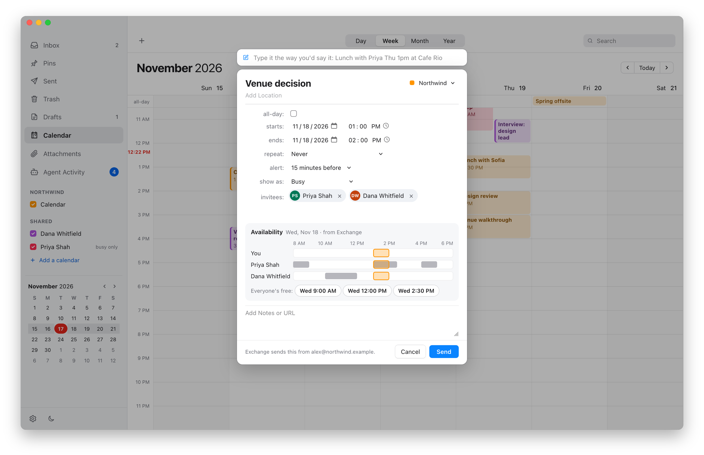

**Shared calendars.** See colleagues' calendars beside yours: in full when they've shared it with you, or just when they're busy.

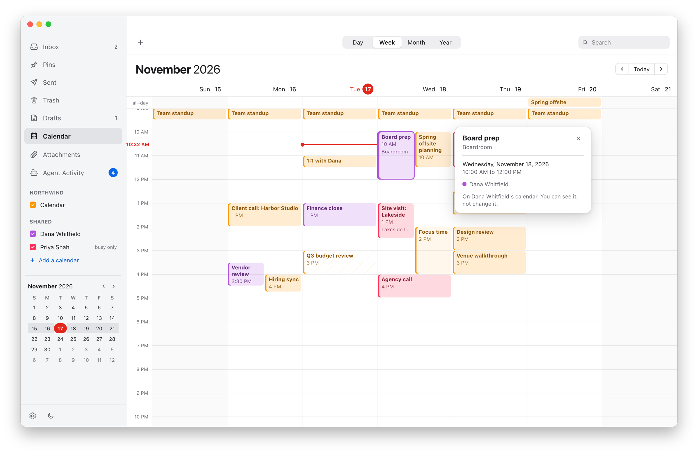

### Attachments

Every file you've received in one place, searchable, with quick look, open and save.

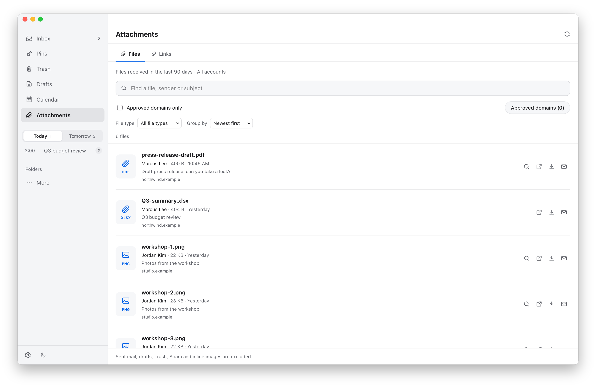

### AI agents, on your terms

Turn on the connector and AI agents like Claude Code can find and read your email, bring things to the top with a note, draft replies and hold time on your calendar. They can never send: Agent Activity shows everything they did, and anything that would reach other people waits for you.

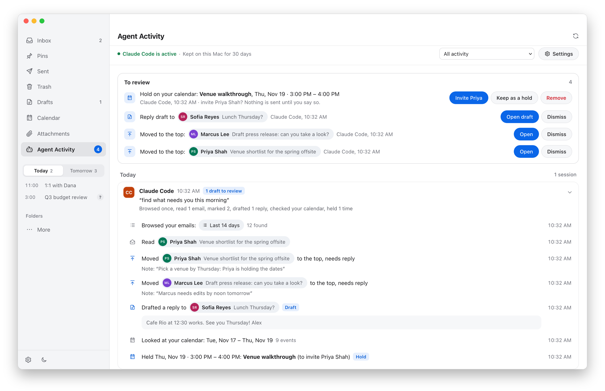

### Lock and dark mode

Lock Ember with Touch ID when you step away, by hand or after a while. Dark mode follows your Mac, and emails can follow it too.

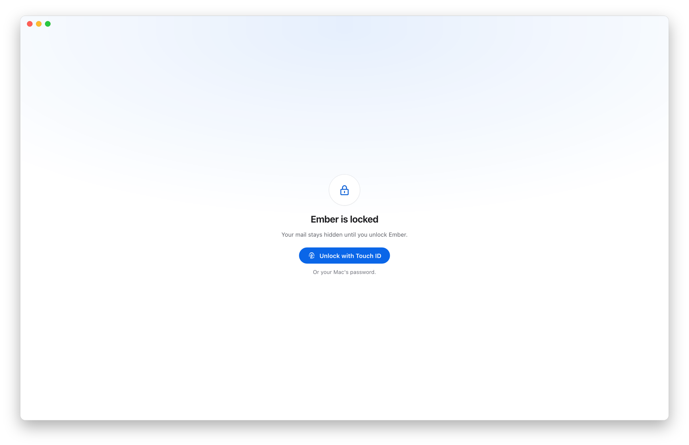

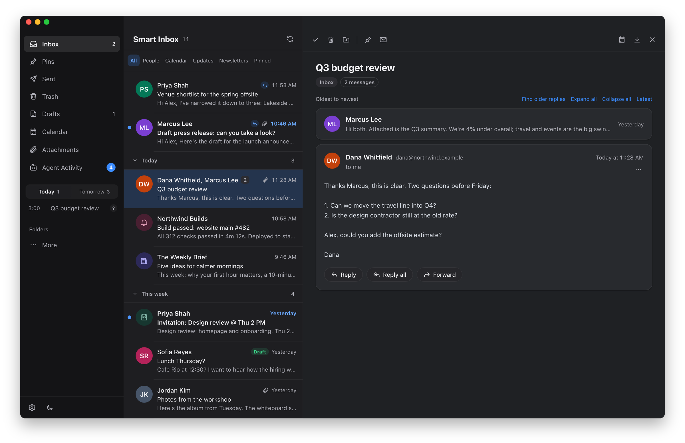

### And more

Optional Work and Personal inboxes, Focus, pins, an undo window for sending, checks that shared links will open for the people you send them to, AI inbox sorting with your own Cloudflare account, and keyboard shortcuts for everything.

## Performance

Measured with Ember 1.0.0 on Thunderbird 158.0.1, a MacBook Pro (M1 Max, 64 GB, macOS 27.2), one account with 2,000 emails from the last 90 days. Each figure is the middle of three runs, taken after everything had settled (Thunderbird's search index caught up; Ember's saved copy of recent mail filled).

| | Memory | CPU while idle |
|---|---|---|
| Thunderbird on its own | 682 MB | 2.8% |
| Thunderbird with Ember open | 891 MB | 1.4% |
| Thunderbird with Ember minimized | 863 MB | 0.6% |

- **Memory:** Ember adds about 200 MB, mostly its saved copy of your recent mail, which lets lists and emails open instantly, even offline. It grows with how much mail you keep.
- **CPU:** Ember uses less than Thunderbird's own window, because it turns off Thunderbird features it doesn't use (its own search index, chat and start page). Minimized, Ember stops drawing altogether.
- Memory is macOS's physical footprint (Activity Monitor's "Memory") for Thunderbird and all its helper processes; CPU is the share of one core over a minute of idling. Your numbers will differ with your mailbox and Mac.

## Your data

Your email stays in Thunderbird on your Mac. Ember has no account, no server and no analytics. It connects to:

- your mail and calendar servers, through Thunderbird;
- GitHub, to check for updates;
- only if you turn them on: Cloudflare (AI sorting, with your own key), VirusTotal (attachment checks, with your own key, sending only a file's fingerprint unless you choose to upload it), and Google, Microsoft and Dropbox (to check whether a shared link opens without signing in).

## Going back to Thunderbird

**Settings → Switch to Thunderbird** shows Thunderbird's own window at any time. To remove Ember: Add-ons and Themes → Ember for Thunderbird → Remove. Thunderbird's own settings and window come back as they were.

## Problems or ideas

Open an [issue](https://github.com/MerrittFranzmann/ember-for-thunderbird/issues), with your Ember and Thunderbird versions (**Settings → Troubleshooting → About**).

---

Ember is an independent project. It isn't made by, or affiliated with, Mozilla (Thunderbird) or Readdle (Spark).

Screenshots show a fictional company, Northwind, and fictional people.
